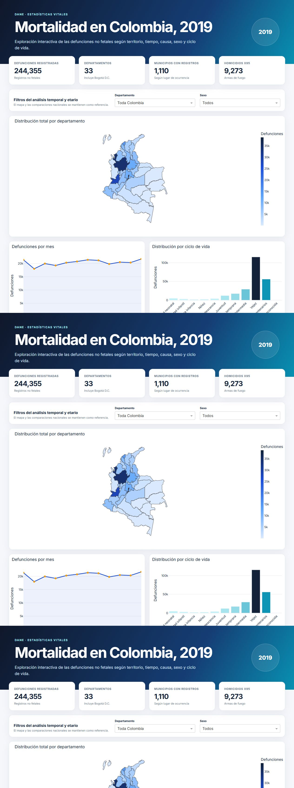
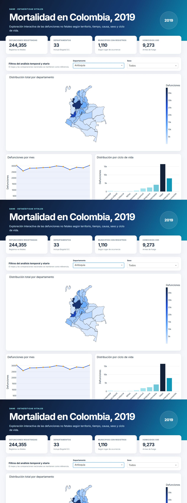

# Mortalidad en Colombia, 2019

## Introducción

Aplicación web dinámica para explorar las defunciones no fetales ocurridas en Colombia durante 2019. El proyecto integra datos de mortalidad, códigos CIE-10 y la División Político-Administrativa de Colombia en un dashboard desarrollado con Dash y Plotly.

## Objetivo

Facilitar la identificación de patrones territoriales, temporales, demográficos y causales de mortalidad mediante visualizaciones interactivas y una presentación accesible desde navegadores de escritorio y dispositivos móviles.

## Visualizaciones

1. Mapa coroplético del total de defunciones por departamento.
2. Serie mensual con filtros por departamento y sexo.
3. Cinco ciudades con más homicidios asociados al prefijo CIE-10 `X95`.
4. Diez ciudades con menor número de defunciones registradas.
5. Tabla de las diez causas específicas de muerte más frecuentes.
6. Barras apiladas de defunciones por sexo y departamento.
7. Distribución por ciclo de vida según los rangos de `GRUPO_EDAD1` indicados en la actividad.

## Estructura del proyecto

```text
mortalidad-colombia-2019/
├── app.py                  # Aplicación Dash
├── prepare_data.py         # Limpieza, cruces y agregaciones reproducibles
├── requirements.txt        # Dependencias de Python
├── render.yaml             # Configuración de despliegue en Render
├── Procfile                # Alternativa para Railway/Heroku
├── assets/
│   └── style.css           # Diseño adaptable del dashboard
└── data/
    ├── raw/                # Archivos originales suministrados
    ├── departamentos.geojson
    └── *.csv / metadata.json # Datos procesados usados por la aplicación
```

## Requisitos

- Python 3.11 o 3.12
- Dash 2.18.2
- Plotly 5.24.1
- pandas 2.2.3
- Gunicorn 23.0.0 (servidor de producción)
- openpyxl 3.1.5 (solo para regenerar los datos procesados)

Las versiones exactas están declaradas en `requirements.txt`.

## Software

- Python
- Dash
- Plotly
- pandas
- Git y GitHub
- Render o Railway para el despliegue

## Instalación local

```bash
git clone URL_DEL_REPOSITORIO
cd mortalidad-colombia-2019
python -m venv .venv
```

Activación en Windows:

```powershell
.venv\Scripts\Activate.ps1
pip install -r requirements.txt
python app.py
```

Activación en macOS o Linux:

```bash
source .venv/bin/activate
pip install -r requirements.txt
python app.py
```

Abrir `http://127.0.0.1:8050` en el navegador.

## Preparación de datos

Los CSV procesados ya están incluidos. Para regenerarlos desde los Excel originales:

```bash
python prepare_data.py
```

El script normaliza los códigos territoriales, vincula municipio y departamento, asigna las descripciones CIE-10, clasifica los grupos de edad y genera todas las agregaciones utilizadas por el dashboard.

## Despliegue en Render

1. Crear un repositorio en GitHub y subir esta carpeta.
2. Iniciar sesión en Render y elegir **New > Blueprint**.
3. Conectar el repositorio de GitHub.
4. Render detectará `render.yaml` y propondrá el servicio `mortalidad-colombia-2019`.
5. Confirmar la creación y esperar a que termine la compilación.
6. Abrir la URL pública asignada por Render y comprobar el mapa, los filtros y la tabla.

Configuración equivalente si se crea un **Web Service** manualmente:

- Build command: `pip install -r requirements.txt`
- Start command: `gunicorn app:server`
- Health check path: `/`

## Resultados principales

- El dashboard analiza 244.355 defunciones no fetales registradas en 2019.
- Diciembre fue el mes con mayor número de registros y febrero el de menor número.
- La distribución por sexo muestra más defunciones de hombres que de mujeres en el total nacional.
- El grupo de vejez concentra la mayor parte de las defunciones, seguido por longevidad y adultez intermedia.
- La categoría X95 se calcula con todos los códigos de cuatro caracteres cuyo prefijo es `X95`.

> Nota metodológica: “menor índice de mortalidad” se presenta como menor número absoluto de defunciones. Calcular una tasa o índice requiere denominadores de población municipal, no incluidos en los archivos suministrados.

## Capturas de pantalla y explicación de resultados

### Vista nacional



La vista nacional reúne 244.355 defunciones. El mapa permite identificar la concentración territorial, mientras la serie mensual evidencia el máximo de diciembre (21.678) y el mínimo de febrero (17.974). La tabla muestra que el infarto agudo del miocardio no especificado (`I219`) es la causa específica más frecuente, con 35.088 casos.

### Ejemplo de exploración: Antioquia



Al elegir Antioquia, la serie mensual y la distribución por ciclo de vida se recalculan sin modificar las comparaciones nacionales de referencia. Este comportamiento permite contrastar el patrón departamental con el contexto general del país.

## Fuentes

- DANE. Estadísticas Vitales, EEVV 2019: https://microdatos.dane.gov.co/index.php/catalog/696
- Capa geográfica departamental basada en el Marco Geoestadístico Nacional del DANE: https://github.com/ytolosa/mapas-colombia
